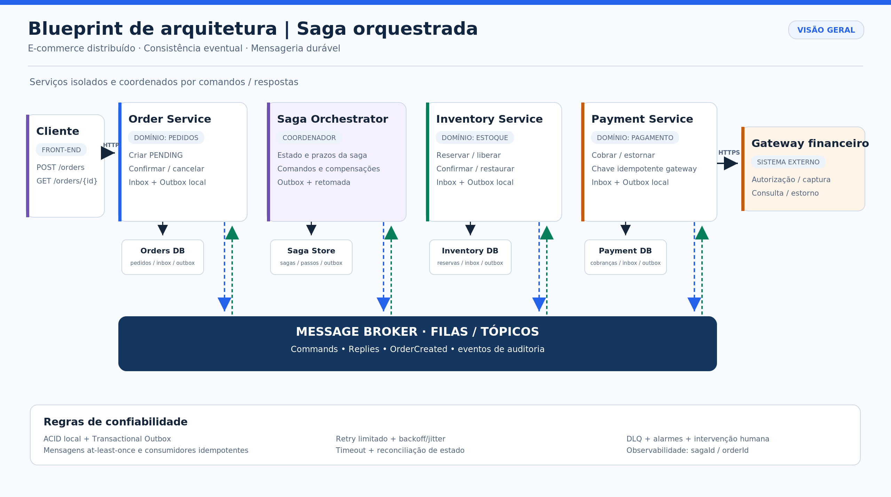
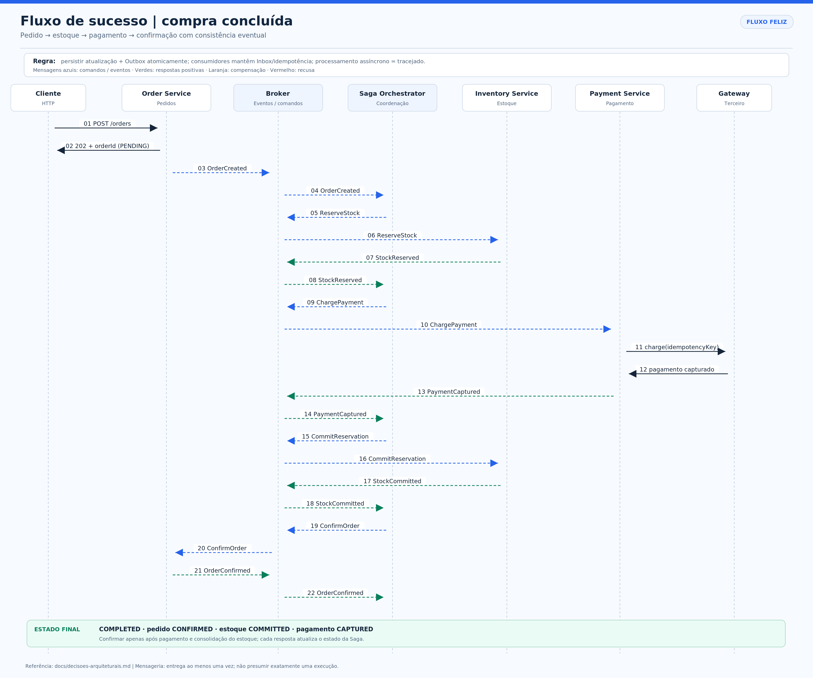
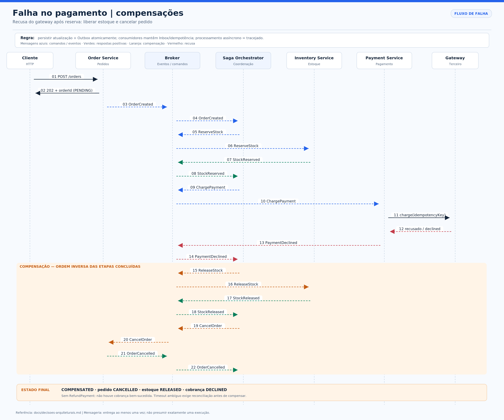

# Blueprint de Arquitetura — Padrão Saga em E-commerce

**Atividade prática de Arquitetura de Software**  
**Estilo adotado:** Saga por **Orquestração**, com mensageria assíncrona e persistência do estado da transação.  
**Escopo:** especificação e diagramas arquiteturais; não inclui implementação de código de aplicação.

## 1. Contexto de negócio

Uma empresa está modernizando o seu monólito de comércio eletrônico e dividindo o processo de compra em três domínios, cada um com banco de dados independente:

- **Order Service:** cria pedidos, mantém os estados `PENDING`, `CONFIRMED` e `CANCELLED` e permite consulta de progresso.
- **Inventory Service:** reserva temporariamente o estoque, confirma a baixa e desfaz a reserva ou uma baixa mediante compensação.
- **Payment Service:** processa cobranças e estornos por meio de um gateway financeiro externo, que pode responder com sucesso, recusa ou resultado temporariamente desconhecido.

A compra não pode depender de uma transação ACID única envolvendo todos os bancos e o gateway. A **Saga** coordena transações ACID **locais** e, diante de falhas, executa **transações compensatórias** para retornar o conjunto do negócio a um estado consistente. Compensação **não** é rollback físico global e a consistência é eventual.

## 2. Decisão arquitetural: orquestração

Foi selecionado um **Saga Orchestrator** independente, com seu próprio banco de controle e comunicação indireta com os participantes por um *Message Broker*. Não há compartilhamento de bancos de dados.

| Critério | Orquestração — escolhida | Coreografia — alternativa |
|---|---|---|
| Controle do fluxo | Estado e decisões centralizados; sequência explícita | Regras espalhadas entre handlers de eventos |
| Acoplamento | Orquestrador conhece **contratos**, não a implementação dos serviços | Serviços conhecem e reagem aos eventos de outros domínios |
| Complexidade | Mais um componente a operar, mas fluxos e compensações visíveis | Menos coordenação explícita; fluxos com muitas etapas tornam-se difíceis de rastrear |
| Escalabilidade | Orquestrador **stateless em execução**, escalável horizontalmente; estado persistido | Consumidores independentes também escalam horizontalmente |
| Falhas | Orquestrador exige alta disponibilidade, retomada e monitoramento | Falhas distribuídas dificultam a visão de ponta a ponta |

**Justificativa:** o fluxo contém decisões relevantes após reserva, cobrança, consolidação do estoque e confirmação do pedido. O coordenador permite manter uma máquina de estados auditável, controlar prazos e ordenar compensações. **Não é um coordenador de transação ACID distribuída**: cada participante continua autônomo e executa transações locais.

## 3. Visão geral da solução



**Componentes:** cliente (HTTP), Order Service, Saga Orchestrator, Message Broker, Inventory Service, Payment Service, gateway externo e respectivos bancos locais. A saída confiável de mensagens usa *Transactional Outbox*; a entrada usa *Inbox / Idempotent Consumer*. O broker entrega mensagens **ao menos uma vez**, de modo que duplicatas são esperadas e tratadas.

O cliente chama `POST /orders` com `Idempotency-Key`; o Order Service persiste o pedido `PENDING` junto com `OrderCreated` na Outbox da mesma transação local e responde `202 Accepted`. O orquestrador processa o evento, registra a Saga e emite comandos pelos canais do broker. O status final pode ser consultado via `GET /orders/{orderId}`.

## 4. Fluxo de sucesso



**Sequência lógica:**

1. Criar pedido `PENDING` e publicar `OrderCreated` por meio da Outbox.
2. Orquestrador comanda `ReserveStock`. O Inventory Service reserva a quantidade de forma atômica e responde `StockReserved`.
3. Orquestrador comanda `ChargePayment`. O Payment Service chama o gateway usando chave de idempotência estável, grava o resultado e publica `PaymentCaptured`.
4. Orquestrador comanda `CommitReservation`; o estoque reservado é convertido em baixa definitiva e o Inventory Service responde `StockCommitted`.
5. Orquestrador comanda `ConfirmOrder`; o Order Service altera o pedido para `CONFIRMED` e responde `OrderConfirmed`.
6. O orquestrador persiste `COMPLETED`. A compra pode então ser considerada concluída.

O `CommitReservation` foi incluído para diferenciar **reserva temporária** de **baixa definitiva**, evitando que uma reserva temporária seja tratada como estoque vendido. As respostas de cada operação são persistidas antes de avançar a máquina de estados.

## 5. Falha de pagamento e compensação



**Cenário avaliado:** o estoque já respondeu `StockReserved`, mas o gateway devolve uma **recusa definitiva** e o Payment Service emite `PaymentDeclined`.

1. O orquestrador registra a recusa; **não** tenta novamente uma falha definitiva de negócio.
2. Envia `ReleaseStock` para desfazer a reserva, aguarda `StockReleased`.
3. Envia `CancelOrder` para finalizar o pedido `CANCELLED`, aguarda `OrderCancelled`.
4. Registra a Saga como `COMPENSATED` e disponibiliza ao cliente o resultado negativo.

**Não** se executa `RefundPayment` neste cenário, porque a cobrança foi recusada. Caso o gateway tenha processado uma cobrança sem enviar resposta, a situação é **indeterminada**, não uma recusa: o Payment Service deve consultar/reconciliar a transação pela chave idempotente antes de autorizar qualquer decisão de compensação.

**Falhas mais tardias:** se o pagamento já tiver sido capturado e o `CommitReservation` falhar definitivamente, a reversão será `RefundPayment → ReleaseStock → CancelOrder`. Se a reserva já tiver sido consolidada e `ConfirmOrder` falhar definitivamente (após eliminar a possibilidade de confirmação executada com resposta perdida), a reversão será `RestoreStock → RefundPayment → CancelOrder`. Nessas condições, a Saga só chega a `COMPENSATED` quando **todas** as compensações requeridas são confirmadas.

## 6. Matriz resumida de decisões e idempotência

| Operação | Chave de idempotência | Efeito permitido uma única vez | Compensação / regra |
|---|---|---|---|
| `POST /orders` | `Idempotency-Key` por cliente + escopo | Um pedido por intenção de compra | `CancelOrder` |
| `ReserveStock` | `sagaId:ReserveStock` | Uma reserva por Saga + item | `ReleaseStock` |
| `ChargePayment` | `sagaId:ChargePayment` no serviço **e no gateway** | Uma cobrança financeira | `RefundPayment`, apenas se capturado |
| `CommitReservation` | `sagaId:CommitReservation` | Uma baixa definitiva | `RestoreStock` |
| `ConfirmOrder` | `sagaId:ConfirmOrder` | Uma confirmação de pedido | Confirmar estado antes de compensar |
| `ReleaseStock` / `RestoreStock` | `sagaId:nomeOperacao` | Uma liberação/restauração | Repetição devolve sucesso anterior |
| `RefundPayment` | `sagaId:RefundPayment` inclusive no gateway | Um estorno da cobrança original | Reconciliar estorno desconhecido |
| `CancelOrder` | `sagaId:CancelOrder` | Um cancelamento | Repetição não cria efeitos novos |

**Regra comum:** um `messageId` repetido é ignorado pela Inbox; um `commandId`/`operationKey` já executado retorna o resultado persistido mesmo se receber **outro** `messageId`. Respostas antigas são ignoradas quando não correspondem ao passo/versão atual da Saga.

## 7. Estados e tratamento de timeouts

A tabela `saga_instances` persiste `saga_id`, `order_id`, `status`, `current_step`, `step_status`, `last_command_id`, `deadline_at`, `next_retry_at`, `attempt`, `version`, `last_error` e `updated_at`. Uma tabela `saga_steps` registra o histórico de tentativas e respostas. O controle de versão evita que duas instâncias do orquestrador avancem o mesmo passo simultaneamente.

Estados principais: `STARTED → WAITING_STOCK → WAITING_PAYMENT → WAITING_STOCK_COMMIT → WAITING_ORDER_CONFIRMATION → COMPLETED`. No cenário da recusa: `WAITING_PAYMENT → COMPENSATING_RELEASE_STOCK → COMPENSATING_CANCEL_ORDER → COMPENSATED`. Para situação ambígua: `RECONCILING` ou `MANUAL_REVIEW` até confirmação externa.

**Timeout não equivale a falha de negócio.** Antes de compensar, o coordenador verifica se o comando foi efetivado; retentativas usam a mesma `operationKey`, prazo limite e backoff com jitter. Depois de esgotar tentativas, a mensagem vai para DLQ com metadados de diagnóstico e o incidente é encaminhado para reconciliação supervisionada.

A descrição detalhada da máquina de estados, contratos, cenários de falha e decisões está em [docs/decisoes-arquiteturais.md](docs/decisoes-arquiteturais.md).

## 8. Estrutura do repositório

```text
saga-ecommerce-blueprint/
├── README.md
├── diagrams/
│   ├── saga-architecture-overview.png
│   ├── saga-architecture-overview.drawio
│   ├── saga-architecture-overview.svg
│   ├── sequence-success-flow.png
│   ├── sequence-success-flow.drawio
│   ├── sequence-success-flow.svg
│   ├── sequence-compensation-flow.png
│   ├── sequence-compensation-flow.drawio
│   └── sequence-compensation-flow.svg
└── docs/
    └── decisoes-arquiteturais.md
```

**Como editar os diagramas:** abra os arquivos `.drawio` em [diagrams.net](https://app.diagrams.net/), escolha **Arquivo → Abrir de → Dispositivo** e salve novas exportações PNG. As versões `.svg` são imagens vetoriais auxiliares; os PNG já estão prontos para anexar à atividade.

## 9. Critérios de aceite da solução

- Uma transação negada pelo gateway libera a reserva e cancela o pedido sem criar estorno indevido.
- Uma duplicação de comando/resposta não gera nova reserva, cobrança, baixa, estorno ou pedido.
- Quedas entre gravação em banco e publicação de evento não geram perda de mensagem (**Outbox**).
- Falhas temporárias podem ser retomadas após reinício do coordenador (**Saga Store + reprocessamento**).
- Nenhuma Saga com compensação pendente é marcada como concluída.
- Timeouts de cobrança acionam **reconciliação**, e não compensação cega.

## 10. Referências técnicas

- Chris Richardson. [Pattern: Saga — microservices.io](https://microservices.io/patterns/data/saga.html).
- AWS Prescriptive Guidance. [Saga orchestration pattern](https://docs.aws.amazon.com/prescriptive-guidance/latest/cloud-design-patterns/saga-orchestration.html).
- AWS Prescriptive Guidance. [Transactional outbox pattern](https://docs.aws.amazon.com/prescriptive-guidance/latest/cloud-design-patterns/transactional-outbox.html).
- AWS Prescriptive Guidance. [Retry with backoff pattern](https://docs.aws.amazon.com/prescriptive-guidance/latest/cloud-design-patterns/retry-backoff.html).

> **Nota acadêmica:** os parâmetros de tempo, tentativas e retenção apresentados na documentação técnica são **propostas de arquitetura**, não medições reais de produção.
